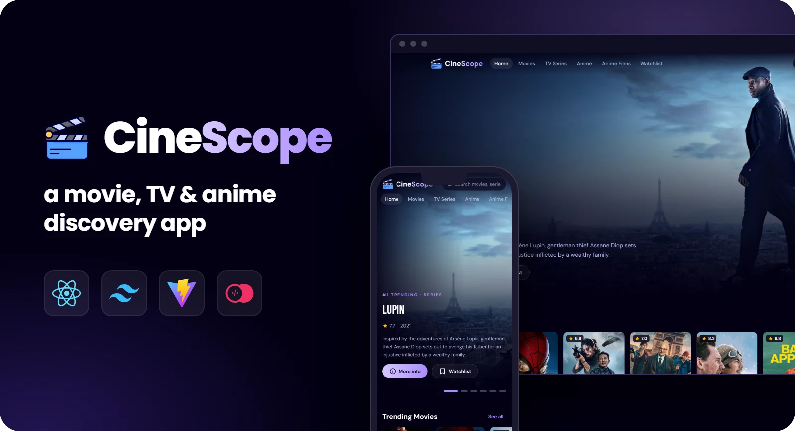

<p align="center">
  
</p>

##

<p align="center">
  
  
  
  
  
  
</p>

<h1 align="center">🎬 CineScope</h1>

<p align="center">
  <b>CineScope</b> is a movie, TV series and anime discovery app built with <b>React 19</b>, <b>React Router</b> and <b>Tailwind CSS</b> on the <b>TMDB API</b>.<br/>
  Browse by category, watch trailers, build a watchlist, and see what everyone else is searching for through an <b>Appwrite</b> backend.
</p>

---

## ✨ Features

- 🎞️ **Category browsing**: Movies, TV Series, Anime and Anime Films, with genre filters and sorting. Filters live in the URL, so every view can be shared
- ♾️ **Infinite scroll** with a "Load more" fallback
- 🔎 **Unified search** across movies and TV, debounced and synced to `/search?q=…`
- 📄 **Detail pages**: rating, runtime or seasons, genres, director or creators, top cast, recommendations and an embedded trailer
- 🔖 **Watchlist** saved in the browser
- 🔥 **"Most Searched" ranking** recorded in Appwrite and shown on the home page
- 📱 Responsive from phone to desktop, with skeleton loaders, empty states, keyboard support and reduced-motion support

---

## 🛠️ Engineering Notes

- **No stale responses**: the previous request is aborted (`AbortController`) whenever inputs change, so a slow response can't overwrite a newer one
- **Pagination hook** that accumulates pages, resets on a new query and de-duplicates TMDB's overlapping results
- **One data shape**: movies and TV shows are normalized in `src/lib/tmdb.js`, so the UI never branches on media type
- **API key stays server-side**: TMDB requests go through the `/api/tmdb` proxy
- **Graceful degradation**: if Appwrite is unavailable, the ranking turns itself off and the rest of the app keeps working

---

## 🌐 Demo

🔗 **Live Demo**: [CineScope](https://cinescope-webapp.vercel.app)

---

## ⚡ Quick Start

Follow these steps to get a local copy of the project up and running.

### 1️⃣ Clone the repository

```bash
git clone https://github.com/Renz-Eryll/CineScope.git
cd CineScope
```

### 2️⃣ Environment setup

Copy `.env.example` to `.env.local` and fill in your values:

```env
TMDB_API_KEY=your_tmdb_read_access_token
VITE_APPWRITE_PROJECT_ID=your_project_id         # optional
VITE_APPWRITE_DATABASE_ID=your_database_id       # optional
VITE_APPWRITE_COLLECTION_ID=your_collection_id   # optional
```

### 3️⃣ Install dependencies

```bash
npm install
```

### 4️⃣ Start the development server

```bash
npm run dev
```

Open **http://localhost:5173** in your browser to view CineScope.

---

## 📧 Contact

- **Name**: Renz Eryll Ramelo
- **LinkedIn**: [www.linkedin.com/in/renz-eryll-ramelo](https://www.linkedin.com/in/renz-eryll-ramelo)
- **GitHub**: [https://github.com/Renz-Eryll](https://github.com/Renz-Eryll)

<sub>Data provided by [TMDB](https://www.themoviedb.org/). This product uses the TMDB API but is not endorsed or certified by TMDB.</sub>
