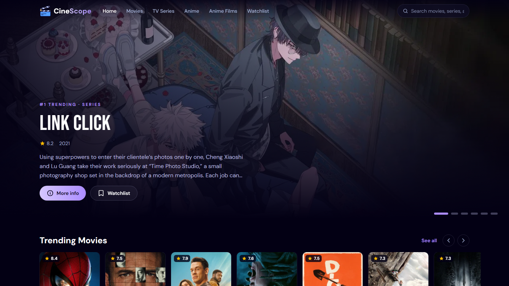
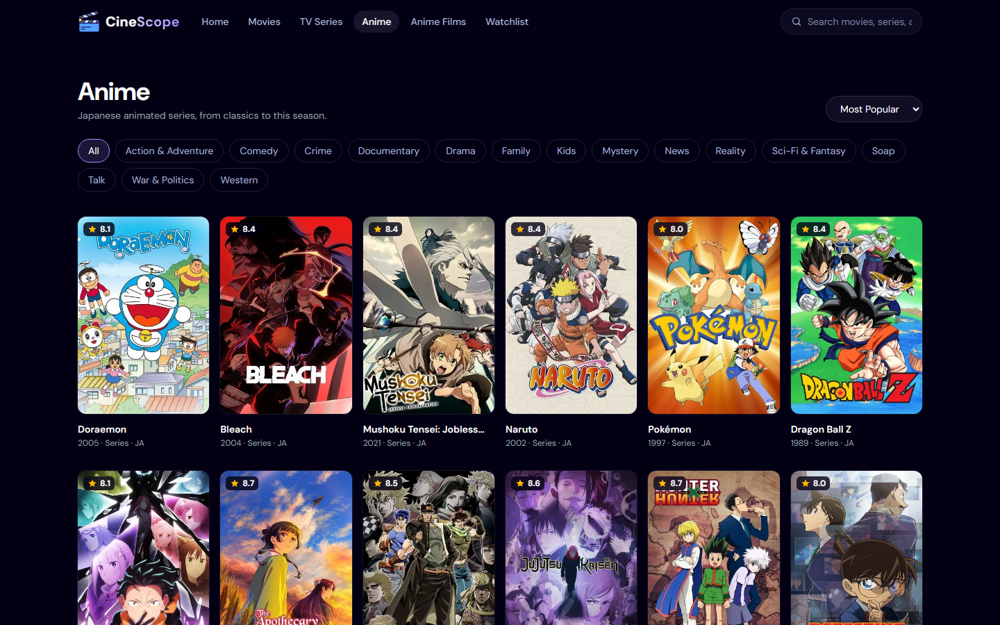
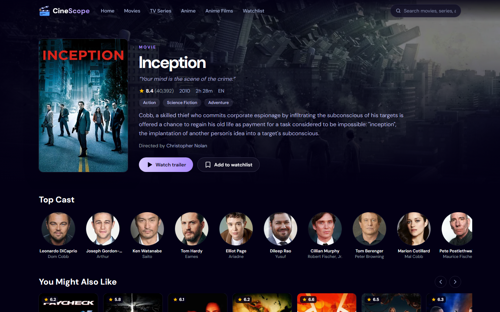

<p align="center">
  
</p>

<h1 align="center">CineScope 🎬</h1>

<p align="center">
  Discover trending movies, TV series and anime: browse by category, watch trailers and build your watchlist.
</p>

<p align="center">
  
  
  
  
  
  
</p>

CineScope is a movie, TV series and anime discovery app built with **React 19**, **React Router**, **Tailwind CSS v4** and the **TMDB API**. An **Appwrite** backend records what users search for and shows the most-searched titles.

## Screenshots

| Browse by category | Title details |
| --- | --- |
|  |  |

## Features

- **Category browsing**: Movies, TV Series, Anime and Anime Films, with genre filters and sorting (Most Popular / Top Rated / Newest). Filters live in the URL, so every view can be shared.
- **Infinite scroll**: paginated results load automatically as you scroll (IntersectionObserver), with a manual "Load more" fallback.
- **Unified search**: one search across movies and TV, debounced and synced to `/search?q=…`, with type filters.
- **Detail pages**: backdrop hero, rating, runtime/seasons, genres, director/creators, top cast, recommendations and an embedded YouTube trailer.
- **Watchlist**: save titles from anywhere; stored in `localStorage` through React Context.
- **"Most Searched" ranking**: searches are recorded in Appwrite (normalized and de-duplicated) and shown as a ranked row on the home page.
- **Rotating hero carousel** of today's trending titles.
- Responsive from phone to desktop, with skeleton loaders, error/empty states, keyboard-accessible controls and `prefers-reduced-motion` support.

## Engineering notes

- **No stale-response races**: `useAsync` aborts the previous request (`AbortController`) whenever inputs change, so a slow response can't overwrite a newer one.
- **Pagination hook** (`usePaginated`) accumulates pages, resets when the query changes, de-duplicates TMDB's overlapping pages and guards against skipped pages from double-fired loads.
- **Normalized data layer** (`src/lib/tmdb.js`): movies and TV shows return different field names (`title` vs `name`, `release_date` vs `first_air_date`); everything is mapped to one shape so the UI never branches on media type.
- **Graceful degradation**: if Appwrite is missing or unavailable, the analytics feature turns itself off and the rest of the app keeps working.

## Project structure

```
src/
  components/   UI building blocks (Navbar, HeroBanner, MediaRow, MovieCard, TrailerModal…)
  context/      Watchlist provider (localStorage-backed)
  hooks/        useAsync, usePaginated, useWatchlist
  lib/          tmdb.js (API client + normalization), appwrite.js (search analytics)
  pages/        Home, Browse, SearchResults, Details, Watchlist, NotFound
```

## Getting started

```bash
npm install
cp .env.example .env.local   # then fill in your keys
npm run dev
```

| Variable | Description |
| --- | --- |
| `VITE_TMDB_API_KEY` | TMDB **API Read Access Token** (v4 bearer token) |
| `VITE_APPWRITE_PROJECT_ID` | Appwrite project ID (optional) |
| `VITE_APPWRITE_DATABASE_ID` | Appwrite database ID (optional) |
| `VITE_APPWRITE_COLLECTION_ID` | Collection with `searchTerm` (string), `count` (integer), `movie_id` (integer), `poster_url` (url) |

## Deployment

This is a client-side-routed SPA, so the host must serve `index.html` for unknown paths. `vercel.json` already handles this on Vercel. On Netlify, add a `public/_redirects` file containing `/* /index.html 200`.

---

Data provided by [TMDB](https://www.themoviedb.org/). This product uses the TMDB API but is not endorsed or certified by TMDB.
